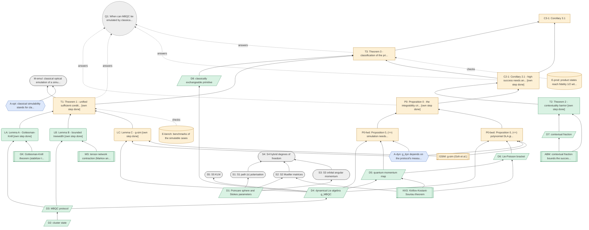

# Lie-Poisson geometric criteria for classical optical emulation in MBQC

_Generated from the argument graph by rmcore - edit the graph, not this file._

## Research questions

- __Q1__ - When can MBQC be emulated by classical optics? _(question, open; open)_: For which MBQC protocols does an efficient classical (optical) emulation exist, and which quantum resources are necessary when it does not?
  - criterion: a criterion for classical simulability, proven in both directions - met by P0
  - criterion: sufficient conditions that can be checked on a protocol - met by T1
  - criterion: an obstruction - what a protocol needs to escape classical emulation - met by C2-1
  - criterion: a classification of the MBQC primitives - met by T3
  - addressed by: P0, T1, C2-1, T3

## Definitions

- __D1__ - Poincare sphere and Stokes parameters _(definition, defined; established)_: rho = (I + sum_i s_i sigma_i) / 2; pure states have |s| = 1, mixed states |s| < 1.
- __D2__ - cluster state _(definition, defined; established)_: |Psi_G> = prod_{(i,j) in E} CZ_ij (x)_{v in V} |+>_v for a graph G = (V, E).
- __D3__ - MBQC protocol _(definition, defined; established)_: Pi = (G, rho_G, M, F, O): graph with gflow, cluster state, measurements M_v(theta_v), feed-forward, output function.
  - rests on: D2
- __D4__ - dynamical Lie algebra g_MBQC _(definition, defined; established)_: g_MBQC = Lie closure of {i H_CZ, i sigma_k^(v)}; Pauli-only generators give dim 3n, with entangling gates dim 4^n - 1 (su(2^n)).
  - rests on: D3
- __D5__ - quantum momentum map _(definition, defined; established)_: mu: S(H) -> g*, mu(rho)_alpha = Tr(rho S_alpha).
  - rests on: D4, KKS
- __D6__ - Lie-Poisson bracket _(definition, defined; established)_: {f, g}(mu) = <mu, [df(mu), dg(mu)]>; {f, g} = 0 iff [df, dg] = 0.
  - rests on: D5, KKS
- __D7__ - contextual fraction _(definition, defined; established)_: C_F(rho) in [0, 1], the minimal weight of contextual correlations; C_F = 0 iff noncontextual model.
  - rests on: ABM
- __D8__ - classically exchangeable primitive _(definition, defined; established)_: Primitive P_i is classically exchangeable if dim(g_i) is in O(poly(n)).
  - rests on: D4

## Assumptions

- __A-dyn__ - g_dyn depends on the protocol's measurement angles _(assumption, assumed; assumed)_: Proposition 0 and Lemma C use an algebra g_dyn that is not defined separately in the documents; it is taken to be a protocol-dependent algebra that can differ between protocols on the same graph.
  - justification: Needed for Proposition 0 to separate protocols at all: g_MBQC of D4 is generated by i H_CZ and all single-qubit Paulis and so does not depend on the measurement angles theta_v.
  - if it fails: If g_dyn = g_MBQC, Proposition 0 classifies every protocol on a connected graph alike (dim 4^n - 1), Clifford protocols included - which Gottesman-Knill simulates efficiently.
- __A-opt__ - classical simulability stands for classical-optics emulation _(assumption, assumed; assumed)_: A protocol that admits efficient classical simulation is taken to admit a classical-optics emulation with polynomial resources (e.g. Mueller-matrix propagation of Stokes vectors).
  - justification: S2 realises single-qubit dynamics with Mueller matrices on Stokes vectors (D1).
  - if it fails: Classical optics encodes multi-qubit states in single-beam degrees of freedom whose number grows exponentially (S1, S3 do not scale); without this assumption the results concern classical simulability, not optical emulation.

## Cited results

- __KKS__ - Kirillov-Kostant-Souriau theorem _(cited, textbook; established)_: Every coadjoint orbit carries the canonical symplectic form omega_mu(xi, eta) = <mu, [xi, eta]>; the Poincare sphere S^2 = SU(2)/U(1) is a coadjoint orbit of SU(2).
  - source: [kirillov2004lectures] coadjoint orbits and the KKS form (Kirillov 2004 [6]; Marsden and Ratiu 1999 [5]) (textbook)
- __GK__ - Gottesman-Knill theorem (stabilizer tableaux) _(cited, published; established)_: Stabilizer-state inputs, Clifford operations and Pauli measurements with classical feed-forward are simulated classically in polynomial time (O(n^2) per measurement with tableaux).
  - source: [aaronson2004improved] Gottesman-Knill theorem; tableau algorithm (exact theorem / section not yet recorded) (published)
  - condition: the input is a stabilizer state - holds by: D2
  - condition: Clifford operations and Pauli-basis measurements, classically controlled - holds by: Lemma A's hypotheses (Pauli-basis measurements, Z2-linear feed-forward)
- __MS__ - tensor-network contraction (Markov and Shi) _(cited, published; established)_: A quantum circuit is simulated in time poly(n) exp(O(tw)) for the treewidth tw of its graph.
  - source: [markov2008simulating] main theorem (exact number not yet recorded) (published)
  - condition: polynomial time requires treewidth O(log n) - holds by: Lemma B's hypothesis (bounded treewidth)
- __GSIM__ - g-sim (Goh et al.) _(cited, published; provisional)_: Expectation values evolve within the dynamical Lie algebra, so they can be simulated in time poly(dim g).
  - source: [goh2025lie] g-sim algorithm (Phys. Rev. Research 7, 033266 (2025), as cited in [7]; theorem not yet recorded) (published)
  - condition: the measured observables lie in (the span of) the dynamical Lie algebra - holds by: NOT SHOWN
  - condition: the evolution is unitary and generated by that algebra - MBQC adds mid-computation measurements and adaptive feed-forward, which the conditions have to be shown to cover
 - holds by: NOT SHOWN
- __ABM__ - contextual fraction bounds the success of l2-MBQC _(cited, published; established)_: For l2-MBQC (Z2-linear classical processing) computing a Boolean function f, the failure probability is at least (1 - C_F) times the normalised distance of f from the affine functions.
  - source: [abramsky2017contextual] the l2-MBQC success-probability bound (Phys. Rev. Lett. 119, 050504 (2017)) (published)
  - condition: Z2-linear classical side-processing (l2-MBQC) - holds by: the hypothesis of Theorem 2

## Results

- __P0-bwd__ - Proposition 0, (<=) polynomial DLA gives simulation _(theorem, sketched; provisional)_: If dim(g_dyn) is in O(poly(n)) or g_dyn is abelian on the relevant observables, the protocol admits efficient classical simulation (Heisenberg evolution stays in a polynomial subspace; g-sim).
  - form: `POLY | AB -> SIM`
  - rests on: D4, D6, A-dyn, GSIM
  - assumptions used: A-dyn
  - proof: archive/docs/MATHEMATICAL_READING_GUIDE_Streamlined.md
- __P0-fwd__ - Proposition 0, (=>) simulation needs a polynomial DLA _(theorem, sketched; provisional)_: If the protocol admits efficient classical simulation, then dim(g_dyn) is in O(poly(n)) or g_dyn is abelian on the relevant observables ("polynomial tracking of <O>").
  - form: `SIM -> POLY | AB`
  - rests on: D4, D5, A-dyn
  - assumptions used: A-dyn
  - proof: archive/docs/MATHEMATICAL_READING_GUIDE_Streamlined.md
- __P0__ - Proposition 0 - the integrability criterion _(theorem, proven; provisional)_: An MBQC protocol admits efficient classical simulation if and only if dim(g_dyn) is in O(poly(n)) or g_dyn is abelian on the relevant observables.
  - form: `SIM <-> POLY | AB`
  - rests on: P0-fwd, P0-bwd
  - assumptions used: A-dyn
- __LA__ - Lemma A - Gottesman-Knill _(lemma, proven; established)_: Pauli-basis measurements with Z2-linear feed-forward give an O(n^2) classical simulation.
  - form: `PAULI -> SIM`
  - rests on: D3, GK
  - proof: archive/docs/MATHEMATICAL_READING_GUIDE_Streamlined.md
- __LB__ - Lemma B - bounded treewidth _(lemma, proven; established)_: A graph of treewidth w gives tensor-network contraction in O(2^w poly(n)).
  - form: `TW -> SIM`
  - rests on: D3, MS
  - proof: archive/docs/MATHEMATICAL_READING_GUIDE_Streamlined.md
- __LC__ - Lemma C - g-sim _(lemma, proven; provisional)_: dim(g_dyn) = d in O(poly(n)) gives classical simulation in O(d^3) by propagation on g*.
  - form: `POLY -> SIM`
  - rests on: D4, A-dyn, GSIM
  - assumptions used: A-dyn
  - proof: archive/docs/MATHEMATICAL_READING_GUIDE_Streamlined.md
- __T1__ - Theorem 1 - unified sufficient conditions _(theorem, proven; provisional)_: Each of the conditions of Lemmas A, B and C implies efficient classical simulation.
  - form: `(PAULI | TW | POLY) -> SIM`
  - rests on: LA, LB, LC
  - assumptions used: A-dyn
  - checked by: E-bench
- __M-emul__ - classical optical emulation of a simulable protocol _(method, proposed; open)_: Emulate a protocol that satisfies a condition of Theorem 1 with classical optics.
  - rests on: T1, A-opt
  - assumptions used: A-dyn, A-opt
- __T2__ - Theorem 2 - contextuality barrier _(theorem, proven; established)_: For a nonlinear Boolean function f with Z2-linear feed-forward, p_s <= 1 - (1 - C_F(rho_G)) d_H(f, Aff_n)/2^n; so high success requires C_F > 0.
  - form: `HPS -> CF`
  - rests on: D7, ABM
  - proof: archive/docs/MATHEMATICAL_READING_GUIDE_Streamlined.md
- __C2-1__ - Corollary 2.1 - high success needs an exponential DLA _(corollary, proven; provisional)_: High success on nonlinear functions requires C_F(rho_G) > 0, "which by contrapositive of Proposition 0 implies dim(g_dyn) not in O(poly(n))".
  - form: `HPS -> !POLY`
  - rests on: T2, P0
  - assumptions used: A-dyn
- __T3__ - Theorem 3 - classification of the primitives _(theorem, sketched; provisional)_: Qubits (P1) and the graph (P3) are classically exchangeable in both the Clifford and the universal case; the cluster state (P2), the measurements (P4) and the algorithm (P5) only in the Clifford case.
  - rests on: D8, T1, C2-1
  - assumptions used: A-dyn
  - proof: archive/docs/MATHEMATICAL_READING_GUIDE_Streamlined.md
  - checked by: E-prod
- __C3-1__ - Corollary 3.1 _(corollary, sketched; provisional)_: Computing classically hard nonlinear functions with p_s -> 1 requires some primitive P_i with dim(g_i) in Omega(4^n).
  - rests on: T3, C2-1
  - assumptions used: A-dyn
  - proof: archive/docs/MATHEMATICAL_READING_GUIDE_Streamlined.md
- __S1__ - S1 path (x) polarisation _(method, proposed; open)_: Two qubits in the path and polarisation of a single beam; dim(g) = 4, does not scale to n qubits.
  - rests on: D1
- __S2__ - S2 Mueller matrices _(method, proposed; open)_: Stokes vectors propagated by 4x4 real Mueller matrices; dim(g) = 3n, no inter-photon correlations.
  - rests on: D1, KKS
- __S3__ - S3 orbital angular momentum _(method, proposed; open)_: Higher-dimensional single-beam encoding in OAM modes; dim(g) = (2L+1)^2.
  - rests on: D1
- __S4__ - S4 hybrid degrees of freedom _(method, proposed; open)_: All classical degrees of freedom combined; polynomial DLA, product-state correlations only.
  - rests on: S1, S2, S3
- __S5__ - S5 KLM _(method, proposed; open)_: Ancillas and postselection give probabilistic entangling gates; exponential DLA (quantum regime).
  - rests on: D4

## Evidence

- __E-prod__ - product states reach fidelity 1/2 with cluster states _(claim, proposed; provisional)_: The maximal fidelity of an n-qubit product state with the n-qubit cluster state is 1/2.
- __E-bench__ - benchmarks of the simulable cases _(claim, proposed; provisional)_: The Python benchmarks in archive/numerical_validation agree with the simulable cases of Theorem 1.

## Open items

- GSIM: provisional
- P0-bwd: provisional
- P0-fwd: provisional
- M-emul: open
- T3: provisional
- C3-1: provisional
- S1: open
- S2: open
- S3: open
- S4: open
- S5: open
- E-prod: provisional
- E-bench: provisional

## Argument map

Arrows run from premise to conclusion; colour = effective standing of the chain (green established, blue assumed, amber provisional, grey open, red invalid); dotted arrows are conditions, corroborating checks and answers.



## Standing of the main results

```
Argument: Lie-Poisson geometric criteria for classical optical emulation in MBQC - 35 nodes
Standing: established 15, assumed 2, provisional 11, open 7
Main results:
  P0 [theorem, proven] effective: provisional | under A-dyn | weakest premise GSIM (provisional)
  T1 [theorem, proven] effective: provisional | under A-dyn | weakest premise GSIM (provisional) | checked by E-bench
  T2 [theorem, proven] effective: established
  T3 [theorem, sketched] effective: provisional | under A-dyn | weakest premise GSIM (provisional) | checked by E-prod
Questions:
  Q1 [open] When can MBQC be emulated by classical optics?
Not established yet: GSIM (provisional), P0-bwd (provisional), P0-fwd (provisional), M-emul (open), T3 (provisional), C3-1 (provisional), S1 (open), S2 (open), S3 (open), S4 (open), S5 (open)
```

## Checker findings

- ERROR LC: uses GSIM without showing its conditions hold: the measured observables lie in (the span of) the dynamical Lie algebra; the evolution is unitary and generated by that algebra - MBQC adds mid-computation measurements and adaptive feed-forward, which the conditions have to be shown to cover
- ERROR C2-1: the logical step does not follow (counterexample: AB=F, CF=T, HPS=T, POLY=T, SIM=T)
- WARN KKS: paraphrased statement not yet compared with the source (checked_against_source)
- WARN GK: paraphrased statement not yet compared with the source (checked_against_source)
- WARN MS: paraphrased statement not yet compared with the source (checked_against_source)
- WARN GSIM: paraphrased statement not yet compared with the source (checked_against_source)
- WARN P0: main result not independently reviewed yet (reviews)
- WARN T1: main result not independently reviewed yet (reviews)
- WARN ABM: paraphrased statement not yet compared with the source (checked_against_source)
- WARN T2: main result not independently reviewed yet (reviews)
